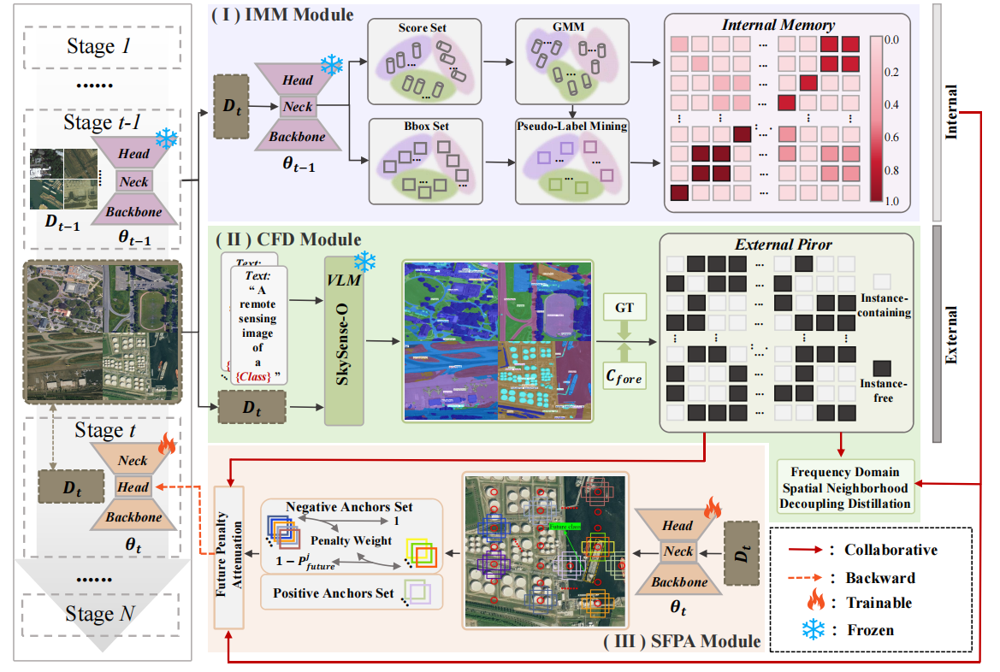

## Internal-External Collaborative Decoupling for Fine-Grained Incremental Remote Sensing Object Detection
Official Pytorch implementation for "Internal-External Collaborative Decoupling for Fine-Grained Incremental Remote Sensing Object Detection", ACM MM 2026.


## 🚀Contributions
- To the best of our knowledge, we are the first to formulate the fine-grained incremental remote sensing object detection task. By addressing the tight coupling between complex backgrounds and cross-temporal classes, we establish a baseline for this challenging task.
- We propose the IECD method, which synergizes external VLM priors with the teacher model's internal memory. Through three modules (IMM, CFD, and SFPA), it decouples cross-temporal classes from complex backgrounds across the probability space, frequency domain, and spatial domain.
- We perform extensive experiments on the FAIR1M and ShipRSImageNet datasets under various settings.

## Get Started
This repo is based on [MMRotate](https://github.com/open-mmlab/mmrotate) and [SkySense-O](https://github.com/zqcrafts/SkySense-O). Please follow the installation of [MMRotate Install](https://mmrotate.readthedocs.io/en/latest/install.html)/[SkySense-O Install](https://github.com/zqcrafts/SkySense-O#dependencies-and-installation) and make sure you can run them successfully.


Method：build_model_SkySenseO (You need to implement it yourself, according to [SkySense-O Demo](https://github.com/zqcrafts/SkySense-O/blob/main/demo/readme.md))
```bash
conda create -n IECD python=3.11 -y
conda activate IECD
cd our project
# Please follow the official MMRotate and SkySense-O Installation Guide to set up this environment (PyTorch, MMCV, MMEngine, etc.).
conda install pytorch==2.0.0 torchvision==0.15.0 torchaudio==2.0.0 pytorch-cuda=11.8 -c pytorch -c nvidia
```

## Dataset
Download the dataset:
- [FAIR1M](https://www.gaofen-challenge.com/benchmark)
- [ShipRAImageNet](https://github.com/zzndream/ShipRSImageNet)
  
After preparing the dataset and configuring the dataset settings, you can simply use our provided scripts to run it directly within the MMRotate framework.

## Acknowledgement
Our code is based on the project [MMRotate](https://github.com/open-mmlab/mmrotate) and [SkySense-O](https://github.com/zqcrafts/SkySense-O).

## Citation
Please cite our paper if this repo helps your research:

```bibtex
@InProceedings{Yang_2026_MM,
    author    = {},
    title     = {Internal-External Collaborative Decoupling for Fine-Grained Incremental Remote Sensing Object Detection},
    booktitle = {ACM MM},
    month     = {},
    year      = {2026},
    pages     = {}
}
```
